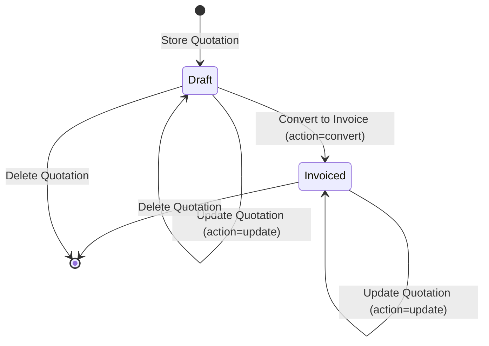

# Quotation Module: Business Logic & Rules

This document details the actual business logic, mathematical algorithms, data validation, and lifecycle operations implemented in the Quotation Module.

---

## 1. Quotation Creation & Update Logic

### 1.1 Creation Workflow (`GET /quotations/create` & `POST /quotations`)
1. **Pre-population**:
   - `QuotationController@create` generates a preview sequence number via `QuotationService@generateSequentialQuoteNumber()`.
   - Defaults the quote date to today's date (`Carbon::now()->format('Y-m-d')`).
   - Initializes a blank line item `['description' => '', 'amount' => 0.00]`.
   - Sets initial status to `'draft'`.
2. **Form Submission (`POST /quotations`)**:
   - Validated via `StoreQuotationRequest`.
   - Handled by `QuotationService@store(array $data)`.
   - Wrapped inside a single database transaction (`DB::transaction`).
   - Server re-generates an authoritative sequential quote number inside the transaction (the quote number displayed on `create` is only an initial preview).
   - Server recalculates line-item totals via `QuotationService@calculateTotals()`.
   - Persists parent `Quotation` record with `status = 'draft'`.
   - Calls `QuotationService@syncItems()` to bulk-insert items into `quotation_items`.
3. **Response & Post-Creation**:
   - `QuotationController@store` redirects back (`redirect()->back()`) to `/quotations/create`.
   - Flashes `success` message: `"Quotation {quote_number} saved successfully!"`.
   - Flashes `quotation_pdf_download` session URL pointing to `route('quotations.download', $quotation->id)`.
   - An invisible `<iframe>` rendered in `form.blade.php` triggers an automatic browser download of the PDF.

### 1.2 Update Workflow (`GET /quotations/{id}/edit` & `PUT /quotations/{id}`)
1. **Loading Existing Data**:
   - Eager-loads line items: `$quotation->load('items')`.
   - Passes `$isEdit = true` to `resources/views/pages/admin/quotations/form.blade.php`.
2. **Form Submission (`PUT /quotations/{id}`)**:
   - Validated via `UpdateQuotationRequest`.
   - Handled by `QuotationService@update(Quotation $quotation, array $data, bool $convertToInvoice)`.
   - Wrapped inside `DB::transaction`.
   - **Pessimistic Lock**: Acquires row lock: `Quotation::whereKey($quotation->id)->lockForUpdate()->firstOrFail()`.
   - Validates conversion status: If `$convertToInvoice === true` and current status is NOT `'draft'`, throws `\DomainException('Only draft quotations can be invoiced.')`.
   - Recalculates subtotal, GST, and total.
   - Updates `quotations` table attributes (retains original `quote_number`).
   - Calls `syncItems()`: Atomically deletes existing items and inserts new line items with updated descriptions, amounts, and 0-based sort orders.
3. **Response & Post-Update**:
   - Redirects to `route('quotations.edit', $quotation->id)`.
   - Flashes `success` message.
   - Flashes `quotation_pdf_download` to auto-trigger the updated PDF download via iframe.

---

## 2. Customer Information Management

### 2.1 Storage Model
In the current implementation, **customer information on quotations is completely standalone and denormalized**. The `quotations` table stores customer data directly as plain strings:
- `contact_person` (varchar 255)
- `company_name` (varchar 255)
- `address` (text / varchar 500)
- `phone` (varchar 30)
- `email` (varchar 255)
- `abn` (varchar 20, nullable)

### 2.2 Integration State with Customer / User Module
- **No Foreign Key**: The `quotations` table does **not** contain a `user_id` or `customer_id` column.
- **No Automatic Customer Creation**: Creating a quotation for a new company or person does not create a corresponding record in the `users` table (`role = 2`).
- **No Autocomplete or Lookup**: The quotation form does not pull from or link to registered customers in the `users` table. Every quotation requires manual entry of contact details.
- **Customer Portal Visibility**: Quotations are not visible to customers in their dashboard (`/dashboard` or `/my-bookings`). They exist strictly in the admin panel.

---

## 3. Quotation Items & Pricing Calculations

### 3.1 Line Item Rules
- A quotation must contain **at least 1 line item** (`'items' => ['required', 'array', 'min:1']`).
- Each line item requires:
  - `description`: String, required, max 255 chars.
  - `amount`: Numeric, required, minimum `0`, maximum `99999999.99` (represents Amount ex GST).
- Deletion in UI: The UI prevents deleting the last remaining row (alerts `"At least one line item is required."`).

### 3.2 Mathematical Formulae
All calculations follow the standard Australian Goods and Services Tax (GST) rate of **10%**:

$$\text{Subtotal} = \sum_{i=1}^{n} \text{amount}_i$$

$$\text{GST Amount} = \text{round}(\text{Subtotal} \times 0.10, 2)$$

$$\text{Total Amount} = \text{round}(\text{Subtotal} + \text{GST Amount}, 2)$$

### 3.3 Client-Side vs Server-Side Execution
1. **Client-Side (JavaScript in `public/assets/js/quotation.js`)**:
   - Triggers on `input`, `change`, and `keyup` events on `.line-item-amount`.
   - Computes:
     ```javascript
     var gst = Math.round((subtotal * 0.10) * 100) / 100;
     var total = Math.round((subtotal + gst) * 100) / 100;
     ```
   - Updates DOM text elements (`#calc-subtotal`, `#calc-gst`, `#calc-total`) with formatted currency strings (`$#,##0.00`).
   - Populates hidden inputs (`#input-subtotal`, `#input-gst-amount`, `#input-total-amount`).
2. **Server-Side Authority (`QuotationService::calculateTotals`)**:
   - The server **completely ignores** the client-submitted hidden inputs.
   - Authoritative recalculation executes on the raw `amount` values submitted:
     ```php
     public function calculateTotals(array $amounts): array
     {
         $subtotal   = round(array_sum($amounts), 2);
         $gstAmount  = round($subtotal * 0.10, 2);
         $total      = round($subtotal + $gstAmount, 2);

         return [
             'subtotal'     => $subtotal,
             'gst_amount'   => $gstAmount,
             'total_amount' => $total,
         ];
     }
     ```
   - Persisted to database columns `subtotal`, `gst_amount`, and `total_amount`.

---

## 4. Quotation Number Generation

### 4.1 Specification & Format
- **Format**: `D2G-{YEAR}-{SEQUENCE}`
  - Example: `D2G-2026-0001`, `D2G-2026-0002`
  - Fixed prefix: `D2G-` (Dust2Glow)
  - Year: Current 4-digit calendar year (`now()->format('Y')`)
  - Sequence: 4-digit zero-padded integer (`0001` through `9999`)
- **Database Constraint**: `quote_number` has a `UNIQUE` index on the `quotations` table.

### 4.2 Generation Algorithm (`QuotationService::generateSequentialQuoteNumber`)
```php
public function generateSequentialQuoteNumber(): string
{
    $year   = Carbon::now()->format('Y');
    $prefix = "D2G-{$year}-";

    $last = Quotation::where('quote_number', 'like', "{$prefix}%")
        ->orderBy('id', 'desc')
        ->value('quote_number');

    if ($last && preg_match('/(\d+)$/', $last, $m)) {
        $next = (int) $m[1] + 1;
    } else {
        $next = 1;
    }

    return $prefix . str_pad((string) $next, 4, '0', STR_PAD_LEFT);
}
```
1. Queries the highest `id` record matching prefix `D2G-{current_year}-%`.
2. Extracts trailing digits via regular expression `/(\d+)$/`.
3. Increments by 1 (or starts at 1 if none found).
4. Zero-pads to 4 digits via `str_pad(..., 4, '0', STR_PAD_LEFT)`.

---

## 5. Quotation Status Lifecycle & Management

### 5.1 Status Values
The database column `quotations.status` supports two primary operational statuses:
- `'draft'` (Default status on creation)
- `'invoiced'` (Status after conversion to invoice)

### 5.2 Status Transitions


- **Draft State**:
  - Badge in DataTable: Yellow/amber (`status-badge-draft`).
  - Allowed actions: Edit, Update, Convert to Invoice, Delete, Download Quote PDF.
- **Invoiced State**:
  - Badge in DataTable: Green (`status-badge-invoiced`).
  - Allowed actions: Edit, Update line items/details, Delete, Download Invoice PDF.
  - Restricted action: Cannot be converted again (`action=convert` is rejected with `DomainException`).
  - No transition exists to revert from `'invoiced'` back to `'draft'`.

### 5.3 Business Metrics Influence
In `QuotationController@index`, the status dictates aggregate dashboard metrics:
- `total_count`: All quotations regardless of status.
- `draft_count`: Quotes where `status = 'draft'`.
- `invoiced_count`: Quotes where `status = 'invoiced'`.
- `total_revenue`: Sum of `total_amount` strictly where `status = 'invoiced'`.
- `current_month_revenue`: Sum of `total_amount` where `status = 'invoiced'` AND `quote_date` is within the current month (`startOfMonth` to `endOfMonth`).

---

## 6. Quotation-to-Invoice Conversion

### 6.1 Meaning in the Current Architecture
In this application, "Converting to Invoice" does **not** create a new record in an `invoices` table (there is no `invoices` table or `Invoice` Eloquent model).
Instead, it is an **in-place status transition** of the quotation:
1. The user clicks the green "Convert to Invoice" button on the edit page (`name="action" value="convert"`).
2. The controller passes `$convertToInvoice = true` to `QuotationService@update`.
3. The quotation is locked (`lockForUpdate()`) to prevent race conditions.
4. `quotation.status` is updated to `'invoiced'`.
5. The quote retains its original `quote_number` (e.g. `D2G-2026-0005`).

### 6.2 Downstream Effects of Conversion
- **Document Header**: PDF document type changes from `"QUOTE"` to `"INVOICE"`.
- **Payment Details Block**: PDF appends a dedicated banking details card:
  - Bank: Commonwealth Bank
  - Account Name: Dust2Glow Group Pty Ltd
  - BSB: 062 709
  - Account Number: 10 450 457
  - Reference: `{quotation->quote_number}`
- **File Name**: Downloaded PDF file name changes from `{quote_number}.pdf` to `{quote_number}-invoice.pdf`.
- **UI State**: On the edit form, the "Convert to Invoice" button becomes disabled and reads "Invoiced".

---

## 7. PDF Generation & Downloads

### 7.1 PDF Architecture
- Powered by `Barryvdh\DomPDF\Facade\Pdf` with paper size set to `'a4'` portrait.
- Endpoint: `GET /quotations/{id}/download` -> `QuotationController@download(int $id)`.

### 7.2 Template Resolution
```php
$isInvoice = strtolower((string) $quotation->status) === 'invoiced';
$documentTitle = $isInvoice ? 'Invoice' : 'Quote';
$view = $isInvoice ? 'pdf.quotation-invoice' : 'pdf.quotation';
```

### 7.3 Data Injected into PDF
1. `$quotation`: Eager-loaded with its line items (`Quotation::with('items')->findOrFail($id)`).
2. `$setting`: Company profile from `Setting::first()`:
   - `company_logo` (rendered via `public_path($setting->company_logo)`)
   - `company_name`, `address`, `phone`, `email`, `abn`
3. `$quoteDateFormatted`: Issue date formatted as `d M Y` (e.g. `13 Oct 2026`).
4. `$dueDateFormatted`: Due date / validity period calculated as:
   `Carbon::parse($quotation->quote_date)->addDays(7)->format('d M Y')`
5. `$documentTitle`: String `'Quote'` or `'Invoice'`.

### 7.4 Automatic Post-Save Download Mechanism
When an admin clicks "Save & Download PDF" or "Update & Download PDF":
1. The form performs a full POST/PUT submission.
2. The controller redirects with:
   `->with('quotation_pdf_download', route('quotations.download', $quotation->id))`
3. In `form.blade.php`:
   ```javascript
   window.addEventListener('load', function () {
       var downloadFrame = document.createElement('iframe');
       downloadFrame.hidden = true;
       downloadFrame.src = @json(session('quotation_pdf_download'));
       document.body.appendChild(downloadFrame);
   });
   ```
4. The hidden iframe triggers the browser file download without redirecting the user away from their form screen.
