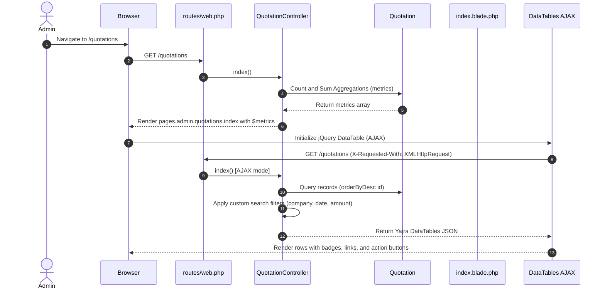
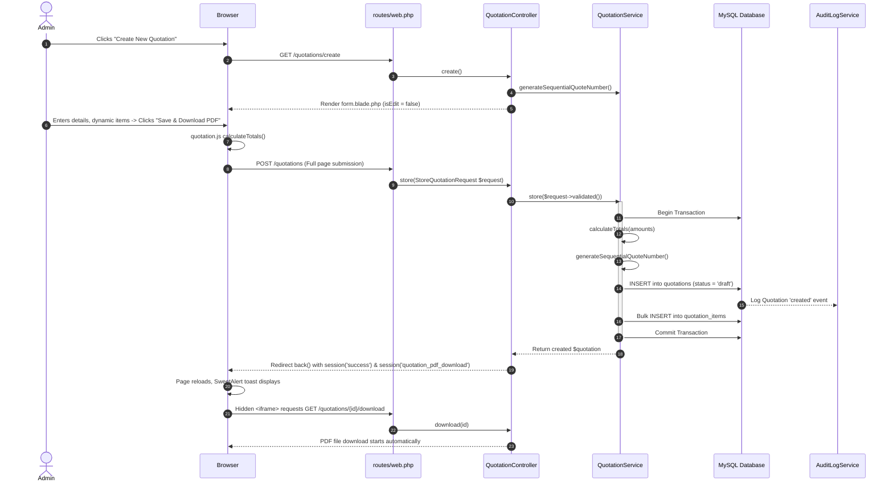
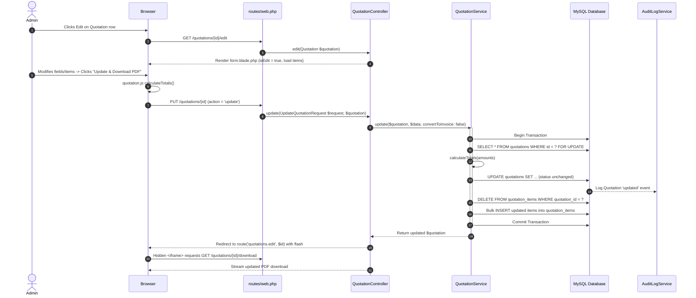
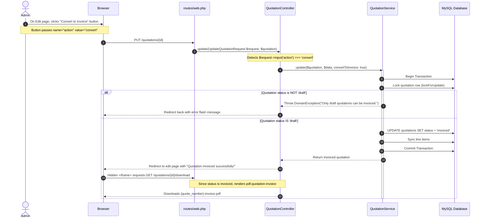
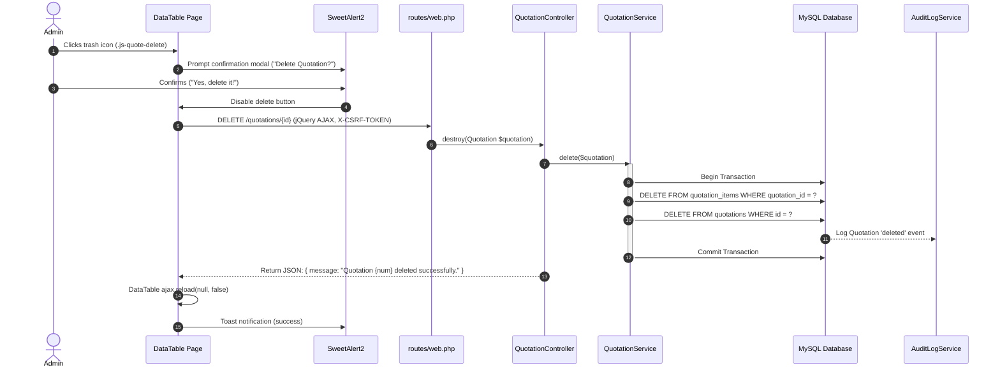
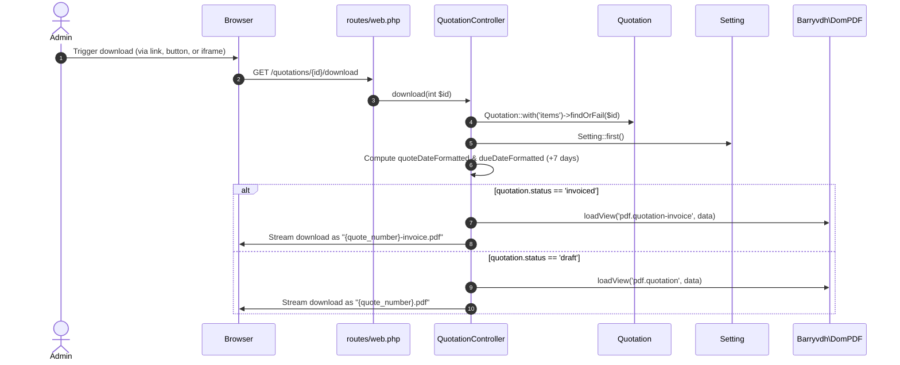

# Quotation Module: Workflows & Execution Flows

This document maps the end-to-end operational workflows and technical execution flows for all quotation features.

---

## 1. Quotation Listing & Dashboard Metrics

### 1.1 Trigger & Flow


### 1.2 Metric Calculation Formulas
- **Total Quotations**: `Quotation::count()`
- **Draft Count**: `Quotation::where('status', 'draft')->count()`
- **Converted Count**: `Quotation::where('status', 'invoiced')->count()`
- **Total Revenue**: `(float) Quotation::where('status', 'invoiced')->sum('total_amount')`
- **Current Month Revenue**:
  ```php
  (float) Quotation::where('status', 'invoiced')
      ->whereBetween('quote_date', [
          $currentMonth->copy()->startOfMonth()->toDateString(),
          $currentMonth->copy()->endOfMonth()->toDateString(),
      ])
      ->sum('total_amount')
  ```

---

## 2. Quotation Creation Workflow

### 2.1 Trigger & Flow


---

## 3. Quotation Update Workflow

### 3.1 Trigger & Flow


---

## 4. Convert-to-Invoice Workflow

### 4.1 Trigger & Flow


---

## 5. Quotation Deletion Workflow

### 5.1 Trigger & Flow


---

## 6. PDF Generation & Download Workflow

### 6.1 Trigger & Flow

